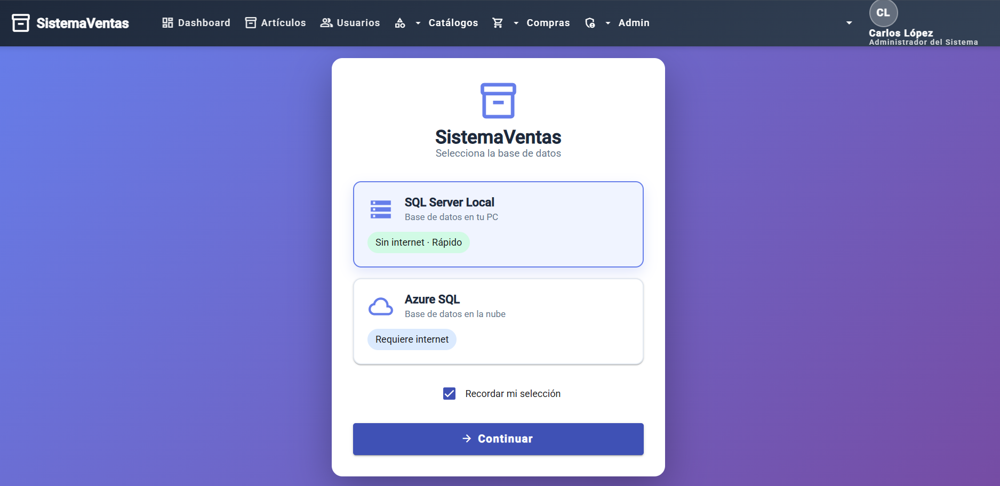

# Iniciar sesión en la aplicación

Pasos para iniciar sesión en la aplicación:

El ingreso al sistema consta de los siguientes pasos, que se detallan en las secciones siguientes:

1. Al iniciar la aplicación, el sistema permite seleccionar la base de datos con la que se trabajará, se selecciona la base de datos (SQL Server Local o Azure SQL), en este caso se eligió el SQL Server.&#x20;

<figure><figcaption></figcaption></figure>

El SQL Server Local:  Base de datos alojada en el equipo del usuario, no requiere conexión a internet y ofrece mayor velocidad de respuesta.&#x20;

Azure SQL: Base de datos alojada en la nube. Requiere conexión a internet.

2. Inicio de sesión con correo electrónico y contraseña.

<figure><figcaption></figcaption></figure>

*   Acceso al Dashboard y a las opciones habilitadas según el rol del usuario.

    <figure><figcaption></figcaption></figure>

###

