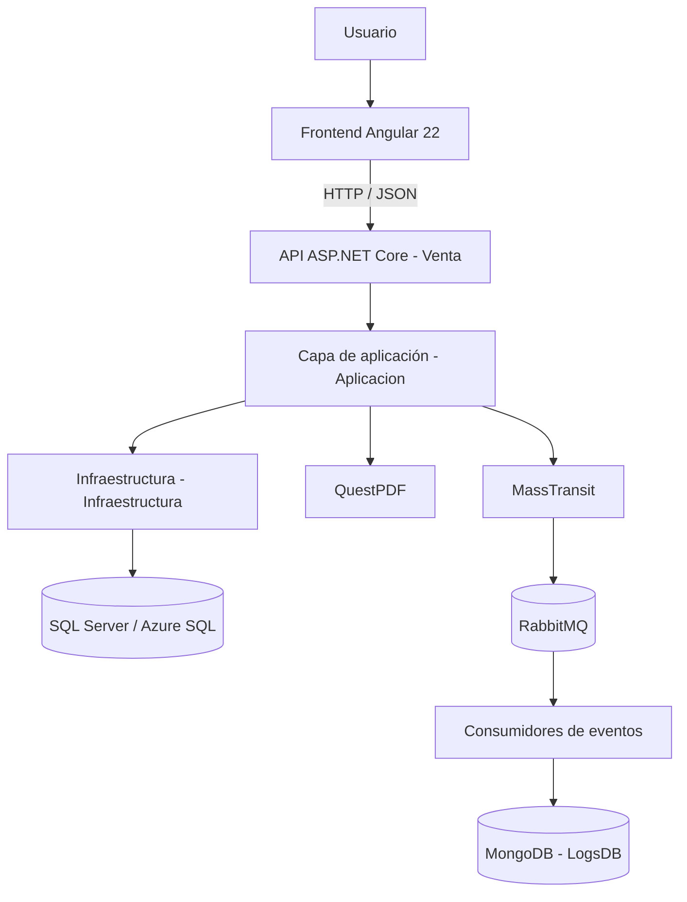

# ARQUITECTURA DE SOFTWARE

## 3. Arquitectura de software

El sistema utiliza una separación por responsabilidades. La solución .NET se divide en tres proyectos y se complementa con una aplicación Angular independiente.

### 3.1 Vista lógica

La figura representa la organización lógica observada en el código. La comunicación con servicios externos requiere que sus respectivos procesos y conexiones estén disponibles en el ambiente donde se ejecuta la aplicación.

### 3.2 Proyecto `Venta` — API y punto de entrada

`Venta` es el proyecto ASP.NET Core que inicia la aplicación del servidor.

Responsabilidades:

* Configurar el contenedor de inyección de dependencias.
* Registrar servicios de aplicación y repositorios.
* Configurar el contexto de Entity Framework Core.
* Seleccionar la conexión SQL según la configuración y el encabezado HTTP.
* Configurar autenticación JWT y autorización por roles.
* Configurar CORS para la comunicación con Angular.
* Registrar MongoDB y MassTransit/RabbitMQ.
* Exponer los controladores REST.
* Habilitar Swagger/OpenAPI.
* Aplicar middleware de autenticación, autorización y manejo de excepciones.

Archivo principal: `Venta/Program.cs`.

### 3.3 Proyecto `Aplicacion` — reglas y servicios

La capa `Aplicacion` contiene los componentes que coordinan las operaciones del sistema:

* DTO para entrada y salida de información.
* Interfaces de servicios.
* Contratos de repositorios.
* Servicios de negocio.
* Perfiles de AutoMapper.
* Eventos y consumidores de mensajería.
* Modelos de entidades utilizados por el contexto y los servicios.

Los controladores no deberían contener la lógica de persistencia directamente. Delegan las operaciones a servicios de esta capa.

### 3.4 Proyecto `Infraestructura` — persistencia

La capa `Infraestructura` implementa el acceso a datos mediante Entity Framework Core y SQL Server.

Contiene:

* `AplicacionDBContexto`.
* Configuraciones de entidades y relaciones.
* Implementaciones concretas de repositorios.
* Migraciones de Entity Framework Core.
* `AplicacionDBContextoFactory`, utilizado para crear el contexto en operaciones de diseño y migración.

### 3.5 Frontend `proyecto-ventas-front`

El frontend está desarrollado con Angular. Contiene páginas, componentes, formularios, modelos, servicios HTTP, guards e interceptores.

La comunicación con la API se realiza mediante solicitudes HTTP. La dirección base definida en los archivos de entorno es `http://localhost:5000/api`.

### 3.6 Patrón de solicitud



## Interacción del usuario

El usuario interactúa con una pantalla Angular.



## Invocación del servicio frontend

El componente invoca un servicio ubicado en `src/app/services/`.



## Solicitud HTTP

El servicio realiza una solicitud HTTP a la API.



## Validación de autorización

El controlador recibe la solicitud y comprueba las políticas de autorización aplicables.



## Ejecución de la lógica de negocio

El controlador llama al servicio de aplicación.

El servicio aplica las reglas de negocio y utiliza uno o varios repositorios.



## Persistencia

El repositorio consulta o modifica los datos mediante `AplicacionDBContexto`.



## Respuesta

La API devuelve el resultado al frontend.



No todas las operaciones siguen exactamente la misma ruta interna. Por ejemplo, `ReportePdfService` realiza consultas mediante `Microsoft.Data.SqlClient` y no utiliza el flujo habitual de repositorios de Entity Framework para generar los PDF.
